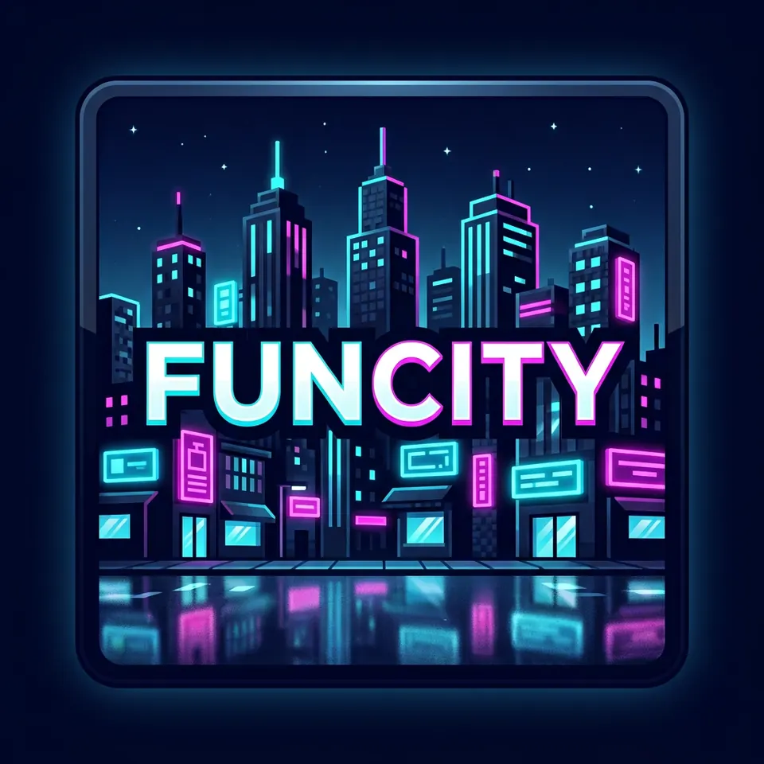

<div align="center">
  
  <h1>FunCity RP Lite</h1>
  <p><strong>Un oraș nou. Povestea e a voastră.</strong></p>
  <p>Minecraft 1.16.5 · conținut modat pentru RP · funcții de comunitate prin pluginuri</p>
  <p><strong>🧪 În laborator · 📂 Dezvoltare publică · ⛔ Fără release Lite sau server public verificat</strong></p>
  <p><a href="START-AICI.md"><strong>START AICI — explicația simplă</strong></a> · <a href="site/index.html">Pagina proiectului</a> · <a href="#stadiul-real">Dovezi și stadiu</a></p>
</div>

---

## De ce FunCity?

FunCity este un proiect de **oraș roleplay construit împreună cu jucătorii**. Vrem să păstrăm conținutul primului pack — mobilier, drumuri, vehicule, arme, mâncare și emote — fără să sacrificăm elementele RP doar ca să scădem numărul de moduri. Joburile, economia, rolurile și autentificarea sunt direcții pentru **pluginuri**, nu funcții pe care le declarăm deja finalizate.

| Ce urmărim | De ce contează | Ce este verificat acum |
|---|---|---|
| **Conținut RP: obiectivul** | Nu promitem un „Lite” golit de obiecte și mecanici. | Șase JAR-uri RP/dependențe identificate din vechiul reper FunCity au fost restaurate în LowSpec; copia de server a pornit. Cele 28 de nume ale originalului Freeroam au fost inventariate; gameplay-ul și conectarea noului profil Lite rămân neverificate. |
| **O cale de intrare pentru PC-uri mai slabe** | Profilul LowSpec este configurat cu 5 chunkuri și maximum 2 GiB heap. | Fișierele sunt verificate pe disc, dar nu există benchmark FPS sau garanție pentru orice laptop. |
| **Optimizări server alese cu rost** | Nu adăugăm zeci de JAR-uri pentru îmbunătățiri presupuse. | RoadRunner, FerriteCore și ModernFix au trecut doar bootul pe o copie; efectul MSPT/RAM rămâne de măsurat înainte de includerea definitivă. |
| **Oraș deschis, moderare responsabilă** | CoreProtect este pentru jurnal și rollback administrativ, nu pentru protecție preventivă de teren. | Pluginul s-a activat în bootul izolat; incidentele reale și restaurarea nu sunt încă probate. |

> **Important pentru jucători:** acesta este un proiect public **în dezvoltare**, nu o invitație de conectare. Nu descărca vechile release-uri ale repo-ului ca și cum ar fi noul FunCity RP Lite. Nu există încă un pachet Lite sau o adresă de server validate pentru intrarea în joc.

**Numele și ținta noului pack: FunCity RP Lite.** [Din 28 de JAR-uri declarate](agent/FREEROAM-LISTA-DECLARATA.json), [ținta de repository](agent/FUNCITY-RP-LITE-SELECTIE.json) exclude 6 numite explicit de proprietar (CTM, DynamicSurroundings, InGameAccountSwitcher, Lightfall Client, Not Enough Animations și TRansliterationLib); celelalte 22 rămân. [Not Enough Animations 1.2.4 cere biblioteca](https://www.curseforge.com/minecraft/mc-mods/not-enough-animations/files/3296039/dependencies), așa că proprietarul a decis scoaterea ambelor din Lite. [Detalii/limite](agent/MODPACK-TINTA-LOWSPEC.md). **Profilul NOU `FunCity RP Lite` cu 22 JAR-uri există pe PC; originalul Freeroam cu 28 este neatins.** [Jobul Windows 39499575969](https://github.com/iZentric/ServerRolePlayLite/actions/runs/39499575969) a verificat copiile față de original, fără lumi/conturi mutate. Identitatea SHA față de sursele originale, pornirea clientului, loginul, compatibilitatea și FPS rămân neverificate; vechiul LowSpec de 21 este alt reper.

**Destinația actuală este profilul NOU `FunCity RP Lite`, separat de Freeroam 1.0.0.** [Reevaluarea istorică de la CUANTIC](agent/REANALIZA-CUANTIC-FREEROAM.md) descrie cererea anterioară de a modifica originalul, înlocuită apoi explicit cu alegerea profilului separat. Runnerul Windows a creat profilul din exact cele [28 de nume inventariate](https://github.com/iZentric/ServerRolePlayLite/actions/runs/39462608606) fără a edita originalul. Compatibilitatea cu serverul existent și conectarea rămân de verificat.

**Originalul ales este Freeroam 1.0.0.** [Runul read-only nou](https://github.com/iZentric/ServerRolePlayLite/actions/runs/39462608606) a confirmat 28 de nume din lista proprietarului în profilul PC, nu identitatea SHA sau compatibilitatea. [Prima comparație](https://github.com/iZentric/ServerRolePlayLite/actions/runs/39439372232) fusese anulată înainte de pasul Windows. [Ce știm și ce nu știm](agent/CONTROL-MODURI-ORIGINALE.md). Nu echivalăm Freeroam cu captura FunCity sau arhiva CUANTIC.

## Stadiul real

| Componentă | Situație verificată | Mai lipsește |
|---|---|---|
| **Motor** | FunCity b1.0827 / Minecraft 1.16.5 a pornit în laborator cu Forge și pluginuri, folosind Guava 21 prin override JVM temporar. | Remediu de distribuție verificat pentru motor; nu este un build final. |
| **Client LowSpec** | [21 JAR-uri la ultima probă PC](https://github.com/iZentric/ServerRolePlayLite/actions/runs/39335419784), inclusiv șase restaurate față de vechiul reper FunCity. În proba istorică erau vizibile LowSpec, EGK, V RP și Fabulously Optimized; acum există suplimentar profilul separat FunCity RP Lite. Alte patru profiluri istorice fuseseră arhivate reversibil. | Comparația Freeroam → LowSpec, lansare client, conectare Forge, RP și FPS/RAM. |
| **Server de bază** | [15 JAR-uri: 11 conținut + 4 dependențe](https://github.com/iZentric/ServerRolePlayLite/actions/runs/39333730944), șase pluginuri nominal active; pornit/oprit pe PC într-un folder temporar, exclusiv loopback. | Instalare numai după validare; serverul existent și lumea sa nu au fost modificate. |
| **Optimizări server** | [Trial PC cu 18 JAR-uri](https://github.com/iZentric/ServerRolePlayLite/actions/runs/39336314432) (cele 15 de bază + RoadRunner, FerriteCore, ModernFix), pornit/oprit curat. | A/B repetat pe copie, cu aceeași lume/sarcină și fără regresii; fără cifre MSPT sau capacitate inventate. |
| **Lansare publică** | Codul și documentația sunt vizibile în repo și în [PR-ul de lucru](https://github.com/iZentric/ServerRolePlayLite/pull/2). | Drepturi/licențe și SHA pentru toate binarele, client+server testate împreună, login prin plugin, voce, backup/restaurare, test RP și aprobare explicită. |

**Test nou:** [cinci motoare au rulat în paralel cu același conținut Lite 15/6](https://github.com/iZentric/ServerRolePlayLite/actions/runs/39431729563): FunCity, CatServer vechi, CatServer oficial și Arclight au pornit/oprit cu șase pluginuri; Mist nu a ajuns la `Done`. Niciun test de boot nu dovedește că un jucător poate intra, iar măsurătorile de pe runner-e/JDK-uri diferite nu pot forma un clasament. [A/B verificat pe aceeași mașină](https://github.com/iZentric/ServerRolePlayLite/actions/runs/39434450455), trei probe/braț cu 40 zombie și lumea generată, cod de ieșire zero și log validat după oprire, a indicat CPU mai mic pentru CatServer vechi **doar în acest test sintetic**; [o rulare intermediară](https://github.com/iZentric/ServerRolePlayLite/actions/runs/39431729723) a eșuat la ultimul B, iar valorile diferă față de [prima rundă completă](https://github.com/iZentric/ServerRolePlayLite/actions/runs/39425133030); fără MSPT, client și RP, nu schimbăm motorul. [Tabelul cu valori și limite](agent/MOTOR-TABEL-VERIFICAT.md) · [Linii de performanță Lite și istoric, separate clar](site/index.html#motoare) · [Selecția optimizărilor](agent/SELECTIE-PERFORMANTA-PURA.md).

## Cum este organizat proiectul

```text
site/                   pagina publică statică (prezentare, nu status live)
agent/                  decizii, audituri și dovezi; unele documente sunt istorice
scripts/fc_modded_*     pregătire și boot izolat pentru conținutul serverului
scripts/fc_pc_lowspec_* modificări controlate ale profilului LowSpec existent
.github/workflows/      verificări, niciuna nu face release Lite sau pornește live automat
```

[Plugin-first](agent/PLUGIN-FIRST.md) rămâne direcția funcțiilor server (joburi, login), dar nu justifică scoateri suplimentare din originalul client Freeroam. Politica actuală este [selecția de 22 din cele 28 nume declarate, cu perechea animații/bibliotecă exclusă](agent/MODPACK-TINTA-LOWSPEC.md); vechile liste server/client 24/29 sunt alt experiment istoric. Un JAR găsit într-un pack vechi **nu dovedește** cine l-a creat sau dacă îl putem redistribui. Candidatul privat conține conținut RP din vechiul reper FunCity, dar păstrarea integrală a originalului Freeroam 1.0.0 nu este demonstrată; nu publicăm acele binare fără verificarea drepturilor.

## Cum poți ajuta

- Citește [progresul verificabil](agent/PROGRES.md) și raportează o eroare prin [Issues](https://github.com/iZentric/ServerRolePlayLite/issues), cu pașii de reproducere și versiunea folosită. **Nu publica loguri brute, adrese, nume de lumi, date de cont sau tokenuri.**
- Dacă deții un JAR din pack, ajută la confirmarea **sursei, licenței și SHA-ului**; prezența lui pe un PC nu este o autorizație de release.
- Pentru contribuții la cod sau documentație, propune o schimbare cu test și explică ce verifică. Nu interpreta succesul unui CI ca pe o probă de FPS, autentificare sau număr de jucători.

**Planul de lansare:** întâi inventarul Freeroam și auditul fiecărui binar/licențe, apoi verificarea că packul candidat păstrează originalul SHA-cu-SHA → import client + conectare la server pe copie → autentificare, voce și scenarii RP → backup și restaurare probate → test A/B pentru optimizările server → abia apoi release și lansare cu acord. [Planul public de lansare](agent/PUBLICARE.md) explică exact ce este public acum și ce blochează pachetul/serverul. [Ghid pentru contribuții](CONTRIBUTING.md).

## Drepturi și siguranță

Motorul derivă din Mohist/Tenet (GPL-3.0); distribuirea unui JAR derivat necesită audit de licență, atribuire și sursă corespunzătoare. Modurile, pluginurile și imaginile pot avea drepturi diferite; **nu există o licență unică declarată pentru tot conținutul din repo**. Nu urcăm lumi, conturi, configurații private, credențiale ori JAR-uri ale altora în noul pack. Release-urile istorice deja existente în GitHub nu sunt certificarea noului Lite.

<sub>FunCity RP Lite · Minecraft 1.16.5 · construit public, testat înainte de a fi promis.</sub>
